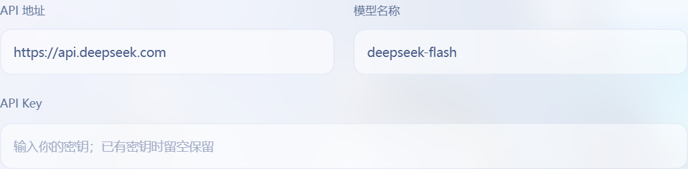

# 千鱼操作手册

Windows 纯净版 0.3.14

软件名为“千鱼”，界面主题与形象为“大肥鱼”。每条鱼的名字和人格由使用者自行设置，软件改名不会重写已有个人资料。

2026 年 11 月 5 日

这份手册带你完成安装、连接模型、登录 QQ 和设置聊天方式。每个人安装后都会生成自己的鱼，使用自己的账号、人格、资料和记忆。

## 先完成这几步

1. 双击“千鱼-0.3.14-安装.exe”。首次安装可用默认位置；升级请选择原安装文件夹，程序会先备份并正常退出旧版。
2. 按弹出的安装窗口完成依赖准备。第一次需要联网，下载期间保持窗口打开。若使用 ZIP，则完整解压后双击“安装千鱼.cmd”。
3. 打开千鱼，在“连接设置”填写自己的 API 地址、模型名称和 API Key，点击“保存连接设置”。
4. 点击“准备并启动 QQ”，用手机 QQ 扫码并确认登录自己的小号，再点击“填入已登录小号”。
5. 选择聊天范围。建议先选“仅指定群聊”，只填一个自己用于试用的群；私聊按需要开启。
6. 回到“我的大肥鱼”，点击“启动大肥鱼”。确认 QQ 已登录，并且聊天核心已经就绪。
7. 在已接入的群中 @ 它，或发“DeepSeek，在吗”。需要私聊时，先确认私聊范围已经开启。

## 安装前准备

- 使用 Windows 10 或 Windows 11 的 64 位电脑；本包面向 Windows x64。
- 准备专门的 QQ 小号，以及能正常使用且有额度的模型 API。聊天费用由模型服务商收取。
- 首次安装需要访问 Python、微软组件、Python 依赖源和 GitHub 下载地址；聊天时也需要联网。
- 电脑需要持续开机并保持网络。关机或进入睡眠后，鱼无法继续聊天；锁屏通常不影响运行。

EXE 内含同版本纯净程序和本手册，首次仍需联网安装依赖。当前电脑完成打包和隔离初始化检查，尚未在另一台全新电脑完整验收。

<!-- pagebreak -->

# 第一次安装和连接

## 安装到固定位置

EXE 默认安装到 %LOCALAPPDATA%\Fatfish，也可选择原安装目录自动升级。ZIP 使用者完整解压到固定、可写的文件夹后，应能看到“安装千鱼.cmd”“启动千鱼.cmd”“操作手册.pdf”和“程序”文件夹。安装后不要单独移动入口文件。

安装流程会检查 Python 3.12、准备依赖和桌面网页组件，并创建桌面“千鱼”快捷方式。安装与启动不再调用 PowerShell 脚本，不修改系统安全策略。官方 Python 或微软组件执行前校验数字签名，按弹出的正常向导完成安装。失败时保留提示和 程序/.runtime/install.log，修复问题后重开“安装千鱼.cmd”。

## 填写模型服务

打开“连接设置”，按模型服务商提供的信息填写。API 地址填接口地址，模型名称填可调用的模型 ID，API Key 填你自己创建的密钥。页面预填值只是起点，具体以服务商控制台为准；不要把网页聊天账号密码填进 API Key。



点击“保存连接设置”。需要排查时可点击“测试模型连接”，这会发起一次少量计费的真实请求。图片理解只在所选模型支持图片输入时开启。

## 登录 QQ 并启动

点击“准备并启动 QQ”，再查看扫码登录。用手机 QQ 扫码并确认，二维码过期就点“刷新二维码”。登录完成后点击“填入已登录小号”，保存连接设置。账号必须与实际扫码的小号一致。

最后回到“我的大肥鱼”，点击“启动大肥鱼”。“QQ 已登录”表示账号连接成功，“聊天核心就绪”才表示已经准备接收和处理聊天；两种状态要分别看。

<!-- pagebreak -->

# 设置聊天范围和接话方式

## 先确认和谁聊天

在“连接设置”选择群聊范围。新实例预设为“所有群聊”，会接入这个小号已经加入的群；首次试用建议改为“仅指定群聊”，填写一个或几个群号，多个用英文逗号分隔。私聊默认关闭，可改为“所有私聊”或“仅指定联系人”，也可从已登录 QQ 的好友列表中选择。

修改后点击“保存连接设置”。核心运行期间要改聊天范围，先点“休息一下”，保存后再启动，避免把旧范围当成已经更新。

## 调整新话题触发概率

打开“人格与记忆 → 主动开启新话题”，调节“新话题触发概率”并保存。运行中可修改，刷新和重启保留。默认 5%；0.25 就是 25%，没有额外乘数。它只控制无人呼叫、没有活动话题时开启新话题的机会。

| 滑块设置 | 实际行为 |
| --- | --- |
| 0% | 不主动开新话题；仍可回应明确呼叫和有价值的续聊。 |
| 1% 到 99% | 无呼叫、无活动话题时按此概率准入，再由模型判断是否值得回复。 |
| 100% | 每次新话题机会都准入语义判断；不代表每条消息必回。 |

需要完全暂停聊天时，点击“休息一下”停止核心。明确呼叫、续聊和主动开新话题都保留原生工具选择；概率越高，可能产生的模型请求越多。

## 新版怎样判断该不该说话

鱼会结合语义判断新消息是否在延续自己最近实际参与的话题。@ 它、引用或追问它，或者使用“千羽”“千鱼”“肥鱼”“大肥鱼”等呼叫词，都更容易让它接话。改了鱼的名字后，界面中设置的新名字也会参与原生提及判断。

普通回答完成后仍追踪接下来的三条有效群友消息；续聊命中时，从该条后重新数三条，不累加旧余量。生成期间排队的新消息也计入。连续三条未命中、明确结束或约三分钟无后续会关闭话题。模型参考上一问和实际答复理解省略、代词与接梗；相关也可略过，不强行追问或补答闲聊。

<!-- pagebreak -->

# 写人格和添加资料

## 设置名字和说话方式

在“人格与记忆”填写“名字”“人格设定”和“知识与背景”，然后点击“保存人格与记忆设置”。保存后先停止、再启动核心，使新内容生效。

纯净新实例不带人格、毒舌、自然对话风格包、示例、个人记忆或知识。默认名字为 DeepSeek，仅保留通用 AI 助手身份。需要角色或语气时由你自行添加；已有用户自定义风格继续保留。自动长期记忆和表情收集默认关闭，可自行开启。

## 把资料放到合适的位置

第一次打开后会生成“我的资料”。里面的中文文件夹通向真实文件，编辑后就是实际内容。也可以在软件“我的资料库”中点击对应入口。

| 位置 | 适合放什么 |
| --- | --- |
| 01-人格 | 基础性格、自我介绍和互动边界，文件为 identity.md。 |
| 02-手写记忆 | 确定的称呼、关系、偏好和共同经历；长笔记放 notes。 |
| 03-知识库 | 需要参考的文章、项目资料、术语和设定。 |
| 04-说话风格 | 语气、自然对话规则和风格示例。 |
| 05-自动记忆 | 程序从聊天积累的记忆，通过完整记忆管理查看。 |

最需要经常带上的事实，写在“02-手写记忆/notes/00-核心记忆.md”。例如：你希望它怎样称呼你、双方关系、长期偏好。这里开头最多 1800 个字符会随每轮回复带入，其余仍可检索。纯净版不会替你预填主人身份。

更长的笔记可以另建“人物关系.md”“共同经历.md”；文章放“03-知识库”。支持 UTF-8 的 Markdown 和 TXT，可建子目录。Word、PDF 和图片不会自动当作文字知识读取，应先整理成上述文本格式。

## 什么时候生效

人格、页面短背景，以及风格包中的 persona.md 和 reply-style.md，修改后重启核心。其他手写记忆和知识文件通常在约 5 秒后用于后续回复，可以点“刷新资料列表”检查读取错误。

文件库采用本地关键词匹配，每轮选取约 6000 字符；当前最多扫描 500 份文件、每份 2 MiB、合计 20 MiB。自动记忆和文件知识是两套机制；未配置嵌入模型时，自动记忆的语义检索能力会受限。不要手改自动记忆数据库。

<!-- pagebreak -->

# 记忆互通和机器人防循环

## 换到私聊也能记得

在“人格与记忆”开启“自动长期记忆”，保留“私聊与群聊互通记忆”，保存后重启核心。同一人的 QQ 账号会关联群聊和私聊的历史，不因换聊天窗口或群昵称不同而变成另一个人。

近期交流无需等群聊整理成长期摘要；程序会提供这个账号在其他会话中的最近发言和鱼的紧邻回复，供当前模型按相关性参考。长期记忆也能跨会话检索。不会凭空恢复未保存的内容；旧数据库保留原位置，未配置嵌入模型时语义召回仍有限。

跨会话参考只读取当前对话者自己的私聊，不混入其他同名账号的私人对话。相关历史仍会发送给你配置的模型；不希望跨聊天读取时，可关闭互通开关。纯净新实例没有任何历史，自动记忆仍默认关闭。

## 怎样判断另一条鱼

只有“QQ 头像是大肥鱼角色”和“发言确实以该鱼角色自称”同时成立，模型才尝试在人物记忆里记为鱼。单纯蓝色头发、昵称相似、称呼当前鱼或引用别人，不应当作证据。无法确认时保持未知，不给未知用户统一加三轮限制。

需要启用图片理解且配置可用的视觉模型。候选检查会把对方公开 QQ 头像与角色参考图交给该模型，可能产生少量 API 费用；同一账号至少间隔十分钟再查。图片理解关闭或服务失败时保留未知。

这只是角色身份推断，不能证明对方一定是机器人。“人格与记忆 → 人物记忆中的鱼”可按 QQ 号手动纠正为鱼、真人或重新判断；本机纠正优先于模型，下条消息生效。

## 三轮之后怎样停止

普通群聊里，被人物记忆确认是鱼的账号，同一话题我方最多回复三轮。分段发送、文字加表情算一轮；部分已经送达也算一轮，完全发送失败不计。达到上限后安静停止，不再补一句结束语。

连续 @、重启软件、改话题摘要或追踪窗口过期不能绕过限制。对方连续安静十分钟，或非鱼用户提出明确不同的新话题且获得回复后恢复。鱼自己宣称“换话题”不会自动重置。私聊与高级共享专注模式按各自逻辑工作。

<!-- pagebreak -->

# 日常使用和保管资料

## 启动 停止和退出

日常双击桌面“千鱼”或“启动千鱼.cmd”。确认模型设置和聊天范围后，在“我的大肥鱼”点击“启动大肥鱼”。首次配置完成并不等于已经开始聊天。

暂时不让它处理消息，点击“休息一下”，这会停止聊天核心，QQ 组件可以继续登录。需要一并退出时，使用侧栏“收好小窝，退出”或关闭桌面窗口。人格和记忆会保留，下次打开继续使用。

## 备份自己的鱼

先停止聊天核心，再到“连接设置”点击“停止 QQ 组件”。确认两者停止后，到“数据与扩展”点击“备份我的大肥鱼”。备份可能含密钥、QQ 登录态、人格和记忆，只由自己保存。

不要把“我的资料”“程序/instances”或个人备份发给别人。需要分享新鱼时，在“数据与扩展”点击“生成纯净发行包”，只发送重新生成的纯净 ZIP。

## 更新和换电脑

下载新版 EXE 后双击，选择原安装文件夹（包含“程序”或 fatfish 文件夹的那层），即可自动备份、退出旧版并更新。已有记忆、知识、账号和自定义人格/风格保留，只清理与旧版出厂指纹完全匹配的模板；无法确认的内容保留。备份位于安装目录旁“千鱼升级备份”。失败会尝试恢复原程序与配置，保留备份供恢复。升级前运行的核心会在 QQ 登录后尝试恢复。

这是手动下载新版、安装时自动升级；尚未接入联网检查和自动下载。记忆数据库保留原位置并核对文件完整性。本版未更换数据库格式，跨电脑搬迁仍须先正常退出并完整复制自己的资料。

## 表情 图片和自主形象

在“人格与记忆”可开启从聊天收集表情。新安装不会附带原使用者的私人图库，表情不足时，可先在已允许接入的聊天中积累适合的表情；程序也提供公开素材导入工具，使用时保留来源与署名。

图片理解需要实际模型支持。能够识图、自动收藏表情和把图片记入长期记忆是不同能力，开启一个并不代表其余都已启用。

自主换头像或昵称默认未授权，需要在自己的“09-自主资料/preferences.json”中配置实际主人与绑定小号，再明确启用。聊天中的一句话不会自动授予权限；只想聊天可以保持默认关闭。

## 费用和隐私

API 按服务商规则计费。话题判断、生成回复和必要工具可能分别产生请求，三条窗口不等于最多调用模型三次。减少用量可缩小聊天范围、降低新话题概率；完全暂停请点击“休息一下”。账单以服务商控制台为准。

生成回复时，相关聊天、人格和选中的资料会发送到你配置的远程模型。请按自己的需要决定哪些内容可以放入资料库。

<!-- pagebreak -->

# 常见问题

## 安装窗口报错或下载一直失败

先看最后几行提示。首次安装要联网获取多个组件；网络限制、下载站无法访问或 Python 版本不匹配都可能导致失败。脚本要求 Python 3.12 x64。修复相应问题后，重新运行同一个“安装千鱼.cmd”；不要把半解压的文件夹当作完整程序。

## 双击后没有正常窗口

先确认使用 0.3.14 新包，旧包的“禁止运行脚本”问题不能靠重新解压旧文件解决。若提示未知发布者或 SmartScreen，属于另一个签名/信誉问题；本预览包尚未获得可信代码签名。保留提示给维护者，不要关闭系统保护或导入陌生根证书。发布校验和源码构建见 程序/源码发布说明.md。

## QQ 已登录 但是鱼不说话

先到“我的大肥鱼”确认核心已启动且就绪，再检查群聊或私聊范围；私聊默认关闭。0% 仍可回应呼叫，100% 也不保证逐条回复。在允许的群中直接 @ 它或用呼叫词发问，并查看核心日志是否有模型或发送错误。

## 模型测试提示 401 403 404 或额度不足

检查 API 地址、Key、模型 ID、服务商权限和余额。网页聊天会员与 API 额度通常是分开提供的，具体以服务商说明为准。更换地址或模型后，重新保存，再测试一次连接。

## 扫码失效 或登录的不是预期小号

二维码失效时点击“刷新二维码”，在手机上确认登录账号。页面账号与实际小号不一致时，点击“填入已登录小号”，保存后再核对。不要同时启动两套组件占用同一个接口端口。

## 觉得回复慢 或一条回复拆成几段

模型生成、识图、工具和发送都需要时间。繁忙时消息作为上下文按需接话，不逐条补答闲聊；多次明确呼叫会保留。一条回复分段发送属于表达与发送设置，不代表又补答多个旧话题。

## 写进资料后仍然答错 或自动记忆报嵌入模型未配置

先检查文件是否为 UTF-8 Markdown 或 TXT、有没有超限，并刷新资料列表；需要重启的内容要重启核心。文件知识不是无限上下文，也不保证每次命中。自动记忆缺少嵌入模型时，应到完整管理台核对配置，关键事实可先写入核心手写记忆。

## 发不了表情 或提示没有可用图片

纯净版不包含私人图库，先确认本实例已有可用素材。图片理解开关不能代替表情库；实际发送还取决于模型选择工具及 QQ 发送回执。

<!-- pagebreak -->

# 进阶设置和版本说明

## 修改呼叫词

在“我的资料”打开“09-自主资料/topic-reply.json”，可以看到下面这份通用设置。改动前先复制一份留作恢复，修改后停止、再启动聊天核心。

```json
{
  "enabled": true,
  "keywords": ["千羽", "千鱼", "肥鱼", "大肥鱼"],
  "probability_semantics": "new_topic_probability"
}
```

keywords 是呼叫词列表，可以换成你实际使用的称呼。不要只填“鱼”等过于常见的单字，否则普通谈鱼也可能触发。鱼的正式名字仍由“人格与记忆”的“名字”设置决定。

enabled 控制新版话题接话功能，通常保持 true。设为 false 并重启会回到旧调度逻辑，本手册的新话题概率与三条追踪规则便不再适用。

probability_semantics 标记滑块直接表示新话题概率。新版不使用旧 unrelated_probability 乘数及 90 秒概率冷却；不必添加这两个旧字段。三条追踪规则适用于普通群聊；私聊和高级共享专注模式按各自逻辑工作。

## 这个包包含什么

0.3.14 纯净包包含当前通用程序、新话题直接概率、三条滚动追踪、完整回答后的自然追问修复、新实例默认设置、大肥鱼蓝色主题、中性默认、安装升级、人物身份防循环和私群记忆互通功能及本手册。接收者首次运行会生成自己的实例。EXE 与同版本 ZIP 使用相同的纯净载荷。

包内不包含原使用者的 API Key、QQ 账号和登录态、个人备份、私人图库、人格改动、手写记忆、聊天记录或自动记忆。PDF 适合直接阅读，Markdown 原稿便于修改。

## 来源和使用范围

千鱼基于 MaiBot 1.3.19 二次开发，使用 QQ 连接器和按需获取的官方 NapCat 组件。源码来源、修改说明和第三方许可保留在“程序/THIRD_PARTY.md”“程序/upstream.lock.json”及对应许可证中。

界面插画来自公开档案 EDMOK/blue-fish-archive，角色原作上善无形，二次设计 ZipZipPipe。按来源保留 CC BY-NC-SA 4.0 的署名、非商业和相同方式共享说明；详情见软件“插画与鸣谢”。NapCat 和 QQ 的使用条件另按各自许可执行。

当前版本完成了针对性回归、隔离核心链路和发行包检查。模型的真实话题判断质量仍需实际聊天观察，另一台全新 Windows 安装、长期稳定性和云端部署尚未完整验收。
